# pxl

**Pixel art as code.** Write a short JavaScript (or TypeScript) file, and pxl renders crisp 1× PNGs,
sprite sheets with JSON tags, animated GIFs, normal and emission maps, Tiled maps, and Aseprite files.
A live browser viewer rebuilds on every save and replays each drawing step by step.

Why draw pixel art in code?

- **Edit structure, not pixels one by one.** Recolor a character in one line, mirror symmetric shapes
  automatically, reuse eyes/weapons/props across variants, and keep silhouettes and hitboxes aligned.
- **Scale up to animation, perspective, and 3D.** Describe a sprite, a platformer tileset, a looping
  parallax landscape, a true-perspective camera, or a 3D form in meters — everything renders cleanly
  as pixel art from one source file.
- **Work by hand or with an AI assistant.** Use pxl directly from the command line with its live
  viewer, or plug it into Claude Code, Codex, or Antigravity (`agy`) so an assistant can draw,
  preview its own work, and iterate while you watch.

> This is a fork of [crsolver/claude-pxl](https://github.com/crsolver/claude-pxl).
> **[Fork differences](docs/fork-differences.md)** summarizes everything added here.

<p>
  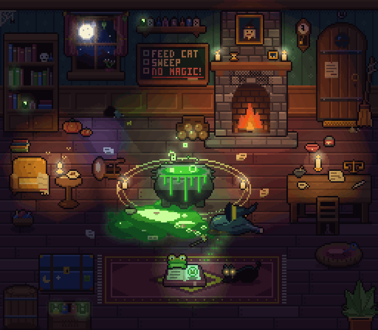
</p>
<p>
  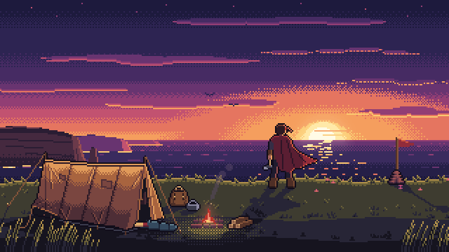
  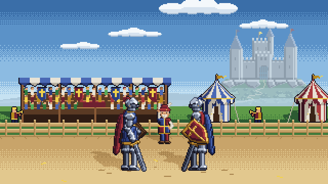
</p>
<p>
  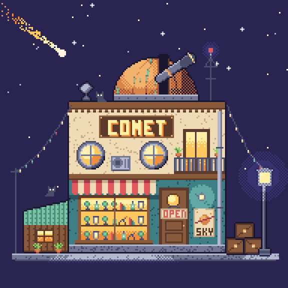
  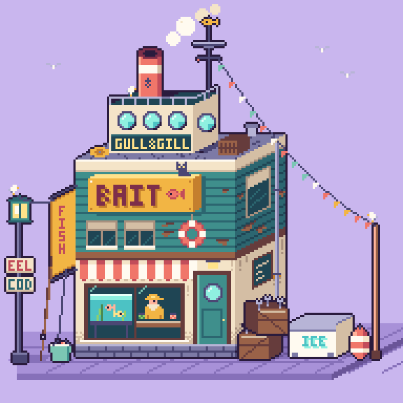
  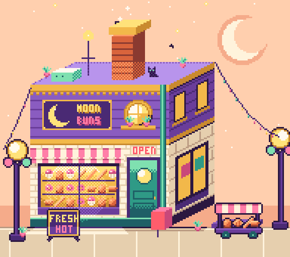
  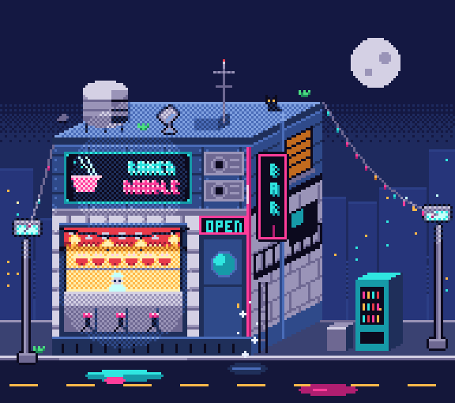
</p>
<p>
  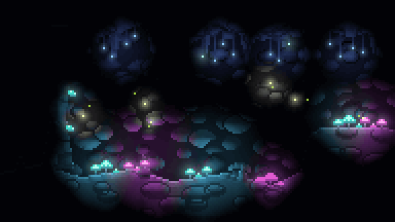
  
  
  
</p>

Every image above is generated from a file in [`examples/`](examples). See [Showcases](#showcases)
below for full animated scenes, HD-2D dioramas, fighting rounds, racing tracks, and 3D-as-pixel-art
projects.

## Contents

- [Install](#install)
- [Your first sprite in 60 seconds](#your-first-sprite-in-60-seconds)
- [What you can build](#what-you-can-build)
- [Use it with an AI assistant](#use-it-with-an-ai-assistant)
- [Commands](#commands)
- [Documentation](#documentation)
- [Showcases](#showcases)
- [Development](#development)

## Install

You only need **Node 22.18 or newer** — no `npm install`, no build step, and no runtime dependencies.

```sh
git clone --depth 1 https://github.com/augusto-scarvalho/claude-pxl.git
cd claude-pxl
node bin/pxl.js serve examples/shop.px.js     # opens the live viewer at http://127.0.0.1:4321/
```

`--depth 1` downloads only the current files (skipping older GIF history, which is much larger);
`git pull` still keeps your copy up to date.

Or run it directly without cloning:

```sh
npx github:augusto-scarvalho/claude-pxl build art.px.js
```

Throughout the docs, `pxl` means `node bin/pxl.js` in your clone (or `npx github:augusto-scarvalho/claude-pxl`).

**Optional tools** (only needed for specific inputs):
- **`ffmpeg`** on your PATH — to inspect JPEG, WebP, or video files with `pxl study`, `pxl shot`, or `pxl compare` (PNG and GIF work built-in).
- **Blender** on your PATH — to convert `.blend` files or inspect them directly via `pxl blender`, `pxl shot`, and `pxl study`.

## Your first sprite in 60 seconds

Create `art.px.js`:

```js
pal({ k: "#1b1630", g: "#8ccf63", G: "#4c8a44", w: "#fff6e0", r: "#e2585e", R: "#a63a4c" })

// Draw only the left half — mx mirrors it and outline wraps it automatically.
sprite("slime", { mx: true, outline: "k" }, `
  ....ggg
  ..ggGGg
  .ggGwGg
  gggkwgg
  GGGGGGG`)

// A full recolor in one line:
sprite("slime_red", { base: "slime", swap: { g: "r", G: "R" } })

sheet("chars", ["slime*"], { pad: 1 })
```

Build it:

```sh
node bin/pxl.js build art.px.js
```

```
out/sprites/slime.png   out/sprites/slime_red.png    1x game-ready sprites
out/chars.png           out/chars.json               packed sprite sheet + JSON metadata
out/_preview/*.png                                   enlarged previews with a pixel grid
```

Run `pxl serve art.px.js` to open the live viewer at `http://127.0.0.1:4321/`. Every save rebuilds
and replays the drawing op by op, so you can see how each shape and shading pass comes together.
Art files can also be `.ts` — [`types/pxl.d.ts`](types/pxl.d.ts) provides full editor autocomplete.

Want a step-by-step walkthrough (animations, scenes, layout rules, and choosing commands)?
Read **[Getting started](docs/getting-started.md)**.

## What you can build

- **2D sprites, palettes, and tilesets.** Draw pixel grids with 1-character palette keys, built-in or
  Lospec palettes (`pico8`, `sweetie16`, `endesga32`, `.hex`/`.gpl`), and hue-shifted shading ramps
  (`shades()`). Mirror shapes (`mx`), auto-outline (`outline`, `selout`, `inline`, `aa`), swap colors
  in one line (`base` + `swap`), and build auto-tiled terrain for top-down (`corners()`), platformer
  (`sides()`), isometric maps, or curved paved paths (`lane()`). Built-in pixel fonts and 9-slice
  panels handle signs and UI.
- **Animations, scenes, and engine-ready exports.** Animate by patching a base sprite (`frame()`) or
  drawing per frame on a clock, with motion smears (`smear`), subpixel motion (`sub`), looping
  parallax (`scroll()`, `clouds()`, `plume()`, `smoke()`), and flexible scene loop modes
  (`loop: "longest" | "hold"`). Place props relative to each other (`beside`, `on`, `along`, `apart`)
  with automatic layout checks (`expect`), optional 2D lamps and normal maps (`lighting()`,
  `bump("hybrid")`, `glow`), and export clean PNGs, GIFs, TexturePacker/Aseprite JSON sprite sheets
  (including normal `_n` and emission `_e` atlases), Tiled `.tmj` maps, `.aseprite` files, and crisp
  integer upscales (`--share 4`) ready to post.
- **Characters, rigs, and a ready-made library.** Animate characters with 2D skeletons and IK
  (`rig()`, `ik`), or pose a 3D figure once and render crisp 4-, 8-, or 16-direction sprites with
  baked heads and hand-painted faces (`rig3d()`, `views()`, `gait()`). Add walking routes (`route()`)
  and dialogue boxes (`bubble()`). Browse [`lib/`](lib/README.md) with `pxl lib` to drop in ready-made
  props, trees, buildings, genre profiles, modular fantasy characters (`lib/characters/kit.px.js`),
  and 8 mount species with riders and wagons (`lib/characters/mounts.px.js`).
- **Shader-style effects and spells (all on the CPU).** Apply deterministic, palette-safe effects to
  sprites, frames, or whole layers with `effect()`: wind `sway` (with gusts and character push),
  `dissolve` (burn, frost, acid, magic, or custom masks), `aura`, `energy`, `distort`, `pixelate`,
  `dither`, and `tint`. Combine `ability()`, `emitter()`, `particles()`, `trail()`, and the built-in
  9-element × 3-tier `spell()` kit (fire, ice, lightning, earth, water, wind, light, dark, heal —
  including 3D-style icebergs, boulders, quakes, and meteors). Finish HD scenes with `post()` depth
  of field, bloom, `.cube` color-grading LUTs, and film grain.
- **True perspective, HD-2D dioramas, and 3D as pixel art.** Lay out scenes in real meters through
  1-, 2-, or 3-point cameras (`perspective()`, `plane()`, `terrain()`, `solids()`, `mesh()`). Build
  3D forms in code with signed distance fields (`sdf`: spheres, boxes, capsules, `lathe`, `prism`,
  blends, noise), render them as crisp pixel art (`surface()`), voxels (`voxels()`), volumetric
  mist/smoke (`volume()`), scattered foliage (`sdf.scatter`), hand-drawn decals (`decal()`), or
  Gaussian splats (`splats()`, including real 3D Gaussian Splatting `.ply` captures). Turn any 3D
  model into compass-named game sprites with `turnaround()`, export `.vox`/`.obj`/`.glb`/`.ply`, and
  spin your 3D models or Gaussian splats right in the browser at `/3d`.
- **Studying 2D and 3D references (including `.stl` and Blender).** Point `pxl shot` or `pxl study`
  at any PNG, GIF, video, folder of frames, or 3D mesh (`.stl` 3D-printing files, `.glb`, `.obj`,
  `.blend`). For 2D art and clips, pxl recovers the native pixel grid, palettes, color ramps,
  outlines, perspective lines, animation timing, parallax speeds, and moving sprites. For 3D models,
  it renders orthographic multi-angle turnaround sheets and prints proportions, symmetry, watertight
  mesh stats, a 10-band silhouette profile, and suggested pixel-art sprite sizes. `pxl blender`
  converts `.blend` ↔ `.glb` and renders matching turnarounds headlessly.

## Use it with an AI assistant

pxl ships as a ready-to-use skill for AI coding assistants — you describe what you want in plain
language (subject, size, palette, motion, or a reference file), and the assistant writes the `.px.js`
code, previews its own renders, checks for layout or visual glitches, and exports your final assets.
You can keep `pxl serve` open to watch the artwork take shape live in your browser.

For **Claude Code**, clone pxl into your skills directory:

```sh
git clone --depth 1 https://github.com/augusto-scarvalho/claude-pxl.git ~/.claude/skills/pxl-pixel-art
```

Update anytime with `git pull` inside that folder (or symlink/junction your existing clone). Then
simply ask: *"Use the pxl skill to draw a 32×32 animated campfire with warm lighting."*

For **Codex CLI**, **Antigravity (`agy`)**, **Cursor**, and tips on writing great briefs, choosing
models, requesting scene edits in plain language, and reviewing animations, see
**[Working with an agent](docs/agents.md)**. The instruction file that AI assistants read is
[`SKILL.md`](SKILL.md).

## Commands

Run `pxl` with no arguments to print every command and option. See
[Which command, when](docs/getting-started.md#which-command-when) for a quick task-by-task cheat sheet.

| Command | What it does |
| --- | --- |
| `pxl build <art.px.js>` | Export 1× PNGs, sprite sheets + JSON, GIFs, Tiled `.tmj`, and previews (`--only`, `--share N`, `--aseprite`, `--every N`, `--profile`, `--quiet`). |
| `pxl serve <art.px.js>` | Start the live browser viewer (`http://127.0.0.1:4321/`) with step-by-step painting replay and interactive `/3d` viewer for exported `.glb` and `.ply` files. |
| `pxl shot <art.px.js> <name>` | Render a quick visual preview of one asset, frame strip, contact sheet (`a+b+c`, `--cols N`), animated GIF (`--gif`), value check (`--grey`), guides (`--ref`), boxes/sockets (`--boxes`, `--sockets`), or before/after diff (`--vs HEAD --diff`). Also previews reference GIFs, videos, and 3D models (`.stl`, `.glb`, `.obj`, `.blend`). |
| `pxl study <input>` | Analyze a reference PNG, GIF, video, PNG frame folder, or 3D model (`.stl`, `.glb`, `.obj`, `.blend`): palettes, ramps, outlines, perspective, animation timing, moving sprites, or 3D turnaround + silhouette proportions. |
| `pxl blender <in.blend\|in.glb>` | Headless Blender bridge: convert `.blend` ↔ `.glb`, sample animation frames (`--frame N`), or render orthographic multi-angle PNG turnarounds (`--renders DIR`). |
| `pxl lib [entry\|subject]` | Browse the built-in asset library (`--genre`, `--cell`, `--all`), inspect an entry's card, or draft a 3D asset into a game genre camera (`pxl lib draft`). |
| `pxl check <art.px.js>` | Validate every scene, animation frame, rig pose, outline edge (`--edges`), and layout rule (`expect` / `expect3d`, auto-repaired with `--fix`). |
| `pxl compare <a...> <b...>` | Compare silhouettes row by row against a reference PNG or another asset (`--anchor` aligns pivots, `--pixels` shows a pixel-by-pixel color diff). |
| `pxl describe <art.px.js> <scene>` | Print a plain-text breakdown of a scene: object positions, overlaps, contrast, lighting, and motion (`--brief`, `--diff`). |
| `pxl ascii <art.px.js> <name...>` | Print exact pixels as palette keys with coordinate rulers (`--trim`, `--anchor`, `--parts`, `--at x,y,w,h`). |
| `pxl steps <art.px.js> <name>` | Show the exact drawing steps and source line (and 3D part) that painted any pixel (`--at x,y`, `--sheet`). |
| `pxl inspect` / `pxl edit` | Find named objects in a scene (`--find`) and apply guarded edits (move, recolor, flip, swap, add) directly in source code (`--dry` previews first). |
| `pxl list <art.px.js>` | Print a quick table of contents for a `.px.js` file with line numbers and comments (`--own`, `--find`). |
| `pxl blind <art.px.js> <name...>` | Export unnamed, shuffled character views so someone can verify facing directions without labels (`--check`). |
| `pxl help [topic]` | Look up any DSL function, option, command, or guide section right in the terminal. |

## Documentation

### Start here & reference

| Read | What's inside |
| --- | --- |
| [Getting started](docs/getting-started.md) | Hands-on guide: first sprite, animation, scene, layout rules, 2D vs. 3D, reference studies, and troubleshooting. |
| [DSL reference](reference.md) | Complete reference for every function, option, and export format (also searchable via `pxl help <name>`). |
| [Asset library](lib/README.md) | Reusable props, nature kits, buildings, characters, mounts, stages, and genre profiles (`pxl lib`). |
| [Examples index](examples/README.md) | One-line guide to every finished example in `examples/` and what technique each one shows. |

### Art & technique guides

| Read | What's inside |
| --- | --- |
| [Scenes & 3D](scenes.md) | Layout, terrain & autotiles, texture without filler, perspective, HD-2D dioramas, parallax, loops, 3D fields, and genre profiles. |
| [Characters & rigs](characters.md) | Proportions, measuring 2D/3D references, faces, clean lines, animation timing, 2D skeletons (`rig`), and 3D multi-direction figures (`rig3d`). |
| [Environment art](environment.md) | Grass, trees, bushes, rocks, stone walls, and paths drawn in classic 16-bit style, with reusable nature kits. |
| [Lighting & normals](lighting.md) | Dynamic 2D lamps, light-blocking walls, glow, and Sprite Fusion-style normal maps. |
| [Sprite rotation](rotation.md) | Free-angle rotation, RotSprite cleanup, and 8- or 16-direction turnarounds. |

### Working with AI assistants & studies

| Read | What's inside |
| --- | --- |
| [Working with an agent](docs/agents.md) | Installing the skill (Claude Code, Codex, `agy`, Cursor), writing briefs, reviewing results, session cost tips, and contributor tooling. |
| [Agent skill map](SKILL.md) | The compact operating guide AI assistants load when using pxl. |
| [Model & workflow studies](docs/model-study.md) | Benchmarks comparing models and effort levels, plus [3D workflow evaluation](docs/evaluation-3d.md) and [scene edit evaluation](docs/evaluation-edit.md). |

### Engineering notes & roadmap

| Read | What's inside |
| --- | --- |
| [Fork differences](docs/fork-differences.md) | Everything this fork adds over the original `crsolver/claude-pxl`. |
| [Performance notes](docs/perf-notes.md) | Profiling, caching, multithreading, and render speed measurements. |
| [Feature write-ups](docs/tier1-tier2-improvements.md) | Notes on [engine & DSL upgrades](docs/tier1-tier2-improvements.md), [mounts & cavalry kit](docs/mounts-improvements.md), and [animation/FX upgrades](docs/fire-slime-improvements.md). |
| [Backlog](BACKLOG.md) | Ideas and open items planned for future work. |

## Showcases

Finished projects built with pxl — every one lives in [`examples/`](examples) so you can inspect,
tweak, or copy its structure. Smaller starter files live in the [Examples index](examples/README.md),
and reusable props, trees, characters, and mounts live in the [Asset library](lib/README.md).

### HD-2D dioramas: a graveyard, a harbor, a clearing

<p>
  
</p>
<p>
  
</p>
<p>
  
</p>

The look of Octopath Traveler's dioramas, in [`examples/hd2d/`](examples/hd2d): the ground built in
meters with `mesh()` (textured boxes laid a texel to a pixel, a hill with an uneven outline), people,
stones and trees standing in it as sprites, shadows from one sun, `post()`'s depth of field. The
traveler ([`traveler.px.js`](examples/hd2d/traveler.px.js)) is a 34 px figure in 3D (`rig3d()`),
his head modeled, baked once per view and its face painted over by hand: he walks his eight
directions along a `route()`, kneels to lay a rose and talks in `bubble()` boxes. In
`graveyard_3d`, beside the graveyard, its dead tree, a ground mist and the swinging gate are drawn in
3D inside the diorama's light (what they take after its `mesh()`), 0.7 s a frame. The harbor's camera was matched by
measuring a screenshot of Octopath Traveler II; its crew ([`crew.px.js`](examples/hd2d/crew.px.js))
is dressed on the traveler's skeleton. The clearing ([`clearing.px.js`](examples/hd2d/clearing.px.js))
has every shader at once: a wood swaying in one wind, a fireball cast from the traveler's hand by the
spell kit, hidden by the wall on its way, a scarecrow burning away, smoke, sparks, bloom and a
`.cube` grade.

### A Japanese shrine in autumn

<p>
  
</p>

[`examples/shrine/`](examples/shrine): a top-down courtyard whose props are drawn once in 3D and
turned by `turnaround` (the torii, the hall, the lanterns, the foxes), under one sun that lights the
3D, the light rule and the shadows. The miko is a `rig3d` figure with a head modeled, baked per view
and retouched by hand. The path is laid along a polyline by `lane()`; the trees come from a kit of
species ([`nature/trees.px.js`](examples/nature/trees.px.js)) built on one grower, each in its
seasons; the Japanese ground and buildings are a kit too ([`nature/japan.px.js`](examples/nature/japan.px.js)).
It began as a scene generated from the skill alone and was then refined in stages.

### A top-down village from the library

<p>
  
</p>

[`examples/village.px.js`](examples/village.px.js): the library's demo for the action top-down
genre at a 16 px grid (`lib/profiles/topdown16.px.js`), every piece taken from `lib/`. The kit was
drawn by hand after measuring The Minish Cap's and A Link to the Past's maps for numbers only: the
ground in regions on corner tiles, round crowns, a house that is mostly roof, a dark line round the
characters only, one light and one shadow. The hero is the genre's base body, and the villagers and
Reva are made from him by `hero.character()`; he walks a `route({ px: true })` and cuts the pot.

### The same village at 32 px

<p>
  
</p>

[`examples/village32.px.js`](examples/village32.px.js): the same genre at a 32 px grid
(`lib/profiles/topdown32.px.js`), every piece from `lib/`. The hero is the genre's slim body at 48 px, painted
over a body posed in 3D; the props are drafted in 3D, brought to the grid with their edges treated
(`shrink: { by, cover, ink }`, `pxl check --edges`) and finished by hand, their forms measured on game models for
numbers only. The trees and the tall grass sway in gusts that cross the scene by `effect("sway")`.

### Racing seen from above

<p>
  
</p>

[`examples/race_topdown.px.js`](examples/race_topdown.px.js): the library's demo for racing seen
from above (`lib/profiles/racing_topdown.px.js`), every piece from `lib/`. The cars are drafted in 3D and
drawn in 32 rotations at the genre's 58 degrees, each frame taking the rotation of the way it moves
(`car.facing`); the track is laid by corner sets, its props and trees drawn by their 3D builders, each lined
in its own dark tones. Two cars lap it in 4 s, slower into the bends, passing and passed back, with skid
marks in the bends; the scene's `expect` holds them on the track, off the props and off each other.

### Racing from behind

<p>
  
</p>

[`examples/race_behind.px.js`](examples/race_behind.px.js): the library's demo for racing from behind,
Mario Kart's kind (`lib/profiles/racing_behind.px.js`), every piece from `lib/`. The track is a map drawn from
above by corner sets and laid on the ground by `plane()`, seen through a camera behind your kart that turns with it
(`perspective({ yaw })`), the backdrop's layers sliding at their own speeds. The kart and its driver are drafted in
3D and painted in 48 headings; your kart steers a step at a time, and each rival takes the drawing of its heading
against the line of sight at the size its distance gives (`kart.rival()`, the smallest by hand). One lap in 8.4 s,
two passes and two passes back; what stands along the track is drawn at a ladder of sizes for its distance.

### A platformer from the library

<p>
  
</p>

[`examples/nightfall/`](examples/nightfall/nightfall.px.js): the library's demo for the platformer
genre at a 16 px grid (`lib/profiles/platformer16.px.js`), every piece taken from `lib/`. A level 4.3
screens long seen through a camera that follows the hero: obstacles by day, a village at dusk, a
castle at night, ending at the keep's door. His way is a `route({ px: "side" })` of runs, a run that
speeds up into a sprint with its soles planted, dashes, jumps by the genre's gravity onto the props'
tops (their `sockets()`) and a ladder climb. The light changes along the level by a palette swap per
layer mixed by the camera's x, and the backdrop's planes are places that scroll in, never copies.

### A fighting game's stages from the library

<p>
  
</p>

[`examples/fighting/`](examples/fighting/shrine_round.px.js): the library's three shrine stages for
the fighting genre (`lib/stages/shrine.px.js`, on `lib/profiles/fighting.px.js`'s 320×224 screen), drawn as
an engine draws a stage from its layout: each layer a sprite as wide as its parallax shows it, the floor
going by row (`parallax: { top, bottom, rows }`: 0.75 at its back, 1 at the fighters' line), what stands
on it at its row's speed, the far ranges by `terrain()`, the kit's torii, hall, lanterns, foxes and trees
drawn in 3D through the fighting camera and planted on their drawn foot (`turnaround(..., { pivot:
"foot" })`). The stage's loops play (flames, a falling leaf, clouds, petals, snow, mist), Reva and Haldor
idle where a round starts, the miko watches in the stage's palette slot, and the HUD is the library's.

<p>
  
</p>

[`examples/fighting/round.px.js`](examples/fighting/round.px.js): the round itself, played by an engine in the file
from the fighters' frame data, as `lib/profiles/fighting.px.js` says an engine reads it: `timeline()` gives each
frame's ticks, drawn box, hit and hurt boxes and data, and a choreography runs once at 60 ticks a second, each move
asked waiting until its fighter is free. Steps and turns, the bodies pushed apart, hits once a move with their
hitstop, shake, pushback and reaction, blocks high and low, a throw and an anti-air grab binding her between his arms,
the wave, sparks, dust and the screen's shake; the camera following the two by the games' tension (after the KO, both
as drawn), the bars and their lag, the timer, the announcer's calls (the HUD's ROUND 1 and FIGHT! before control, K.O.
on the knockout, timed by the HUD's layout), the KO slowed, the winner's pose (`win`) as her marker lights. Its rules
are checked every tick (no bodies overlapping, both on the screen, no move ending with a back to the other, life
falling only on a hit, no hit on the floor landing deeper than the reach table's 20 px), and the scene draws a picture
every 2 ticks from what it kept.

### 3D as code: fields, voxels, volumes, splats, decals

<p>
  
</p>

Everything here is described in meters, in code, and drawn as pixel art by pxl itself, on the CPU
([`examples/sdf/`](examples/sdf)): the forms are distance fields drawn by `surface()`, the mist and
the smoke densities ray-marched by `volume()`, the leaves and moss details scattered on the forms, the
door, the sign and the spirit's face hand-drawn decals pinned on them. The scene is data
(`world3d`): "a denser canopy, twistier branches, wind from the left" is an edit that leaves the house
and the rock byte for byte as they were, and its rules are checked by `pxl check`. The same fields
go out as voxel models, meshes and splats (`.vox`, `.obj`, `.glb`, `.ply`), or as a game's sprites
turned to each heading by `turnaround` ([`turnaround.px.js`](examples/sdf/turnaround.px.js)).

### A spell kit: elements, tiers, variants, views

<p>
  
</p>

A whole cast in one call, `spell("ice", 3, { from: "hero.hand", to, variant: "iceberg" })`
([`spells.px.js`](examples/spells.px.js), [`spell_variants.px.js`](examples/spell_variants.px.js)):
nine elements at three tiers, variants with a form (an iceberg, a falling boulder, a quake, a
meteor), seen from the side, from above, in iso or through a camera, in a diorama's depth.

### A cyberpunk street at dusk, made two ways

<p>
  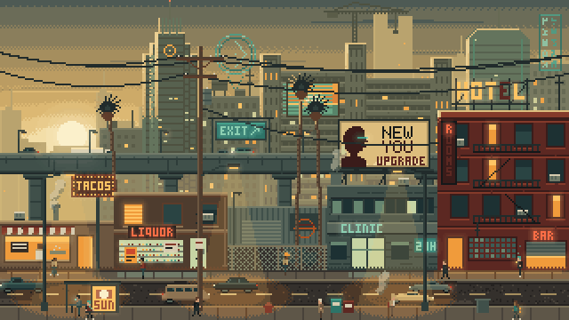
</p>
<p>
  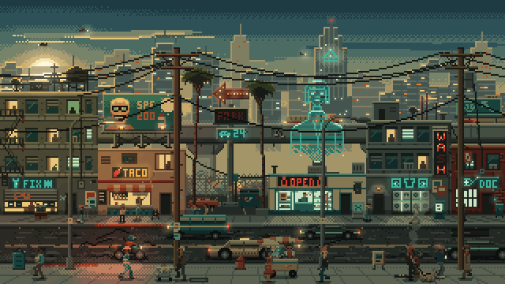
</p>

One brief, a 320×180 street, made twice from the skill alone ([`examples/cyberpunk/`](examples/cyberpunk)).
On top, one agent: 85 turns in 31 minutes. Below, a pipeline (a planner, eight forks drawing parts at
once, a last fork assembling): denser but less coherent, for about five times the tokens and twice
the time.

### Knights built skeleton first, at a tournament

<p>
  
</p>

A 72 px knight built as [`characters.md`](characters.md) §11 describes ([`examples/rig/`](examples/rig)):
a `rig()` of slots with stand-ins, parts drawn from plates lit on their own, ordered by the way he
faces and turned with `turn`; each pose of the 96-frame bout set by IK, the sparks, dust and fanfare
on one clock.

### True perspective

<p>
  
</p>
<p>
  
</p>
<p>
  
</p>
<p>
  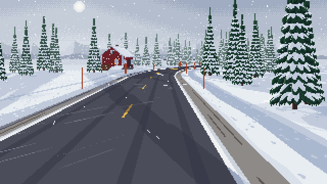
</p>

Scenes laid out in meters through a camera ([`examples/perspective/`](examples/perspective)): the
[road](examples/perspective/road.px.js) in one point, the walker shrinking into sprites drawn by hand
for the small sizes; the [park](examples/perspective/park.px.js) in two, solid shapes cast by one sun;
the [extinction](examples/perspective/extinction.px.js) in three, a volcano by `terrain()` and
everything burning by `flame()`; the [winter road](examples/perspective/bend.px.js) from a cab, a road
laid out once whose bends the camera puts into the ground, the shadows and the 3D firs alike.

### Parallax and a cockpit

<p>
  
</p>
<p>
  
</p>

The [train](examples/parallax/train.px.js): the land runs past in planes that wrap (`scroll`), each a
whole number of px a frame, so none judders and the loop closes. The
[race](examples/perspective/race.px.js): the road bending through the camera, rivals drawn by hand at
seven sizes, the cockpit modelled in meters and drawn by `mesh()`, each mirror another camera. A level
longer than the picture: a scene's `camera` follows the hero as a platformer's does, each layer moving
by its `parallax` ([camera](examples/camera.px.js)).

### Journey's end, a Halloween party, a tropical forest

<p>
  
  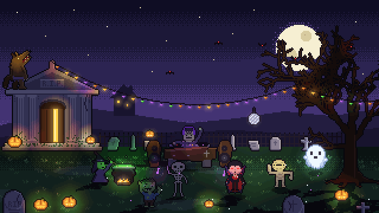
  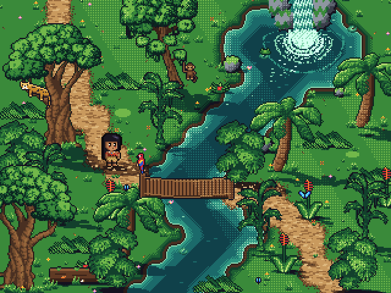
</p>

A backlit sunset on a sea cliff ([`examples/sunset/`](examples/sunset)): what faces us in shadow,
edges toward the sun glowing, a tent lit through, a sky looping slower than the rest. A night party
lit only by `lighting()` ([`examples/halloween/`](examples/halloween)): eight monsters on one cycle,
throwing their silhouettes away from the lamps. The first long project, a 320×240 jungle
([`examples/tropical/`](examples/tropical)): its trees, palms and big leaves are reduced from "[LPC]
Jungle" by bluecarrot16, Lanea Zimmerman (Sharm), Sevarihk, Hyptosis and others, and from Sevarihk's
"Animated Palm Tree Sprite", both CC-BY 4.0: credit their authors when you reuse them
([`refs/CREDITS.md`](examples/tropical/refs/CREDITS.md)). The rest is drawn in code, MIT.

## Development

```sh
npm install                                          # dev only: typescript, @types/node
node --test test/docs.test.ts                        # one test file, while you iterate
PXL_EXAMPLES=hd2d node --test test/examples.test.ts  # the examples' check on one folder
npm run test:quick                                   # every test but the two slowest
npm run check                                        # type check + every test, before a commit
```

How long each takes, and what makes a run check everything again: [Tests](docs/agents.md#tests).

```
src/core/     engine, no Node APIs: image, palette + ramps, canvas ops, build, trace, project, study
src/node/     vm sandbox loader, PNG/GIF encoders, outputs, CLI, live server
src/viewer/   browser viewer (served type-stripped; no bundler)
types/        pxl.d.ts globals for editor support in .px.ts files
scripts/      the maintainers' scripts, below
lib/          the library to include: props, buildings, nature, characters, vehicles, effects, UI, stages, styles, the genres' profiles
examples/     example art files
test/         node:test suites
```

| Script | What it does |
| --- | --- |
| `scripts/build.js` | writes `dist/` for npm installs |
| `scripts/blender_pxl.py` | headless Blender worker invoked by `pxl blender` for `.blend` ↔ `.glb` conversion and multi-angle renders |
| `scripts/gallery.ts` | regenerates `docs/gallery/` from the examples (`--out DIR` to look first, `--every N` for a quick look; `--lib`: the library's sheets) |
| `scripts/calibrate.ts` | scores `pxl study` against the examples' own source |
| `scripts/perf.ts` | `pxl check`'s time, processor time and peak memory on every example; `--vs <rev>`: ms a frame, that revision's pxl against yours |
| `scripts/hashes.ts` | a hash of every asset of the files given (none: every example and `lib/` file); `--vs <rev>`: what differs from that revision's pxl and where (`--png` writes both), `--frames` frame by frame, `--data` with each frame's boxes, sockets, pivot, ms and data, for an engine change that shouldn't move a pixel |
| `scripts/vs.ts` | what `hashes.ts`, `perf.ts` and `served.ts` share: a revision's `src/` and `examples/` unpacked once into the temp folder |
| `scripts/served.ts` | what the live viewer sends and holds for one asset (`--vs <rev>`: that revision's server first) |
| `scripts/pulse.ts` | how many of an animation's normals turn from frame to frame on the parts that only moved |
| `scripts/meter.ts` | preloaded into the tests, each test file's time, processor time and peak memory |
| `scripts/cpuprofile.ts` | a CPU profile of any pxl command, summed by function |
| `scripts/tokens.ts` | where a Claude Code session's tokens went, read from its transcript |
| `scripts/model-study.sh` | one run of the [model study](docs/model-study.md): a brief to a new Claude Code, Codex or `agy` session |
| `scripts/eval3d.ts` | what an edit of a 3D scene changed, part by part, and what it shouldn't have ([evaluation-3d.md](docs/evaluation-3d.md)) |
| `scripts/evaledit.ts` | what an edit of a scene changed, by id, and the pixels outside what the request names ([evaluation-edit.md](docs/evaluation-edit.md)) |
| `scripts/mhtml.ts` | saved web pages (`.mhtml`) opened as text and images, to read tutorials |

How to use them, and how to update the examples' snapshot after a change you meant, is in
[Working with an agent](docs/agents.md#for-contributors); what each of pxl's speed-ups gained, machine by machine, is in
the [performance notes](docs/perf-notes.md).

In a clone the CLI runs the TypeScript sources directly. When installed as a package it runs
`dist/`, which `npm install` / `npm pack` generate via `scripts/build.js` (Node won't strip types
inside `node_modules`).

## License

[MIT](LICENSE)
