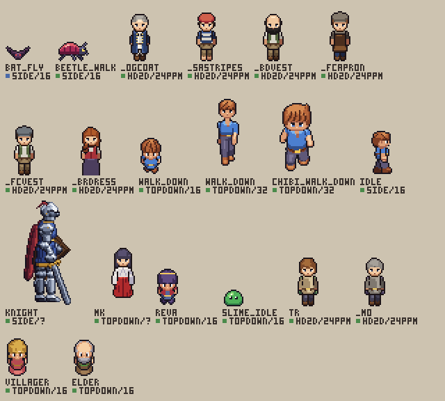

# The library

What pxl draws with, in three layers:

- **the engine** (`src/`): the ops, the builders, the cameras, the light, the export;
- **the library** (here): entries to include rather than redraw, the styles, the profiles;
- **the examples** (`examples/`): finished work, each a profile × entries × a style.

## Taking an entry

Each file holds one kind of thing and says how to take it, in its first lines:

```js
include("<pxl>/lib/props/lamps.px.js", { as: "lamps" })   // its names under lamps.: stamp("lamps._lamp", 40, 60)
sprite("lamp", { base: "lamps._lamp_square", swap: roleSwap(lamps.ROLES._lamp_square, { line: "k", frame: "nM", light: "Llw" }) })
```

- `as` keeps its names apart from yours. Its palette stays with its own drawings unless the file says
  `{ palette: true }` (the nature kit, the HD-2D profile): then its keys are yours too.
- A drawing comes in the colors of the scene it was made for. Its roles (`<kit>.ROLES`) name its keys by
  what they paint (line, wood, light), so `roleSwap()` gives it yours by `base` and `swap`.
- A kit hands out functions and data too (`trees.mats`, `nature.spruce()`, `dialog.PARCHMENT`); the
  names it hands out are full ones (`own()`).
- A 3D thing is a builder, `make3d.oak()`: drawn by `turnaround()` or `draw3d()` at any camera and size.

## What exists, and at which cells

`pxl lib` lists the entries by subject, a line each, with their cells: the camera and the density each
exists at (a tile's px, `topdown/16`; px a meter in a world with no tiles, `hd2d/24ppm`), ✓ approved,
◐ a 3D render to look at, ✎ by hand over a 3D draft (`side/?`: drawn for one scene, neither).
`pxl lib --genre topdown16` keeps those at a profile's cell, `pxl lib --cell side/32` those at a cell.
`pxl lib traveler.tr` prints one's card: what it is, its source, its size, pivot, sockets and frames,
its roles, what varies, and the `include` that takes it. A 3D entry a genre lacks: `pxl lib draft
make3d.oak --genre topdown16` writes and builds an art file to start from, in the genre's camera (what
stands at its `stand` pitch, else its figure's), the genre's box for the card's category (else the card's tiles), its
tones and line (`--cell topdown/16`: a cell alone). A 2D entry at a new density is redrawn simpler, never scaled (`pxl help "scenes 18 19"`).

Each entry's card is a `card()` call just after it in its file: a renamed entry or asset fails the
load at the card's line, and `pxl check` on the file warns where a cell's status disagrees with how
its asset is drawn. A new entry gets one.

## The sheets

Each card's cells, frame 0, its name and cell under it (the swatch: green ✓, amber ◐, blue ✎); a
builder drawn at its first cell. Made by `node scripts/gallery.ts --lib`.

**Props** (`props/`): lamps and crates from the examples' scenes; a top-down village's pot (and its break),
chest, sign, crate, barrel, lamp post and fence (`village.px.js`); a platformer's crate, lamp post and spinning
coin, side on (`side.px.js`, `platformer16`; at dusk and at night by `props.DUSK` and `props.NIGHT`, the lamp unlit by
day by `props.UNLIT`); a platformer village's well, hay cart, barrel, hanging sign and
lantern post (`side_village.px.js`).


**Nature** (`nature/`): the kit's ground, pines, bushes, rocks and dead trees; the tree species as
builders, the oak, the maple and the spruce also by hand at `topdown/16` (their 3D drafts frozen in
`frozen/`); the cave's caps; the top-down island's ground (`island.px.js`: the shore, a path and a darker
grass by corners, the field's tiles, tall grass, a bank's earth front and a hedge in rows of tiles, flowers
and a bed of them, a bush, a rock, a stump); a platformer's world side on (`side.px.js`, `platformer16`: the
ground as tiles by their open sides under a grass lip, their faces and undersides ragged, slopes, water, an oak, a
pine, two bushes, the backdrop's far and near clouds and hills; `side.ground(map)` draws a level; the same at dusk
and at night by a palette swap, `side.DUSK` and `side.NIGHT`, with the sky as the air at each time, `side.sky`, and
the full moon).


**Characters** (`characters/`): the traveler and the people on his figure (the crew, the miko), what
they wear (`dress.px.js`), the top-down hero and the people made from him (`hero.character()`: two villagers,
Reva's chibi), the same hero at 48 px for top-down 32 on the genre's slim body (`hero32.px.js`, `topdown32`: idle,
walk, run and the sword attack with its crescent) and on its chibi body (`chibi_*`, to approve), the same hero side on for a platformer (`hero_side.px.js`,
`platformer16`: idle, walk, run and sprint (a run that speeds up), a dash with its afterimage and dust, a jump in four to loop the rise and the fall (jump, apex,
fall, land), hurt, a ladder's climb and his back at a door), a slime,
the knight, a beetle that walks and a bat that flies (a platformer's enemies).



**Architecture** (`architecture/`): the shrine's builders, the HD-2D surfaces, the cottage (by hand at
`topdown/16`, mostly roof; its 3D draft frozen), the island's pier; a platformer's one-way platforms, ladder,
spikes and door (`side.px.js`, at dusk and at night by `built.DUSK` and `built.NIGHT`); a platformer village's old houses as a 3D builder, `make3d.old_house` (a stone
floor, a half-timbered storey, a tile roof and its chimney), finished by hand with the painted doors, windows lit at
dusk and shutters set into its openings, the same three drawn by hand of modules as alternatives (`house_a_2d`...),
its wall and the dusk town behind, by day and at night by `village.TOWN_DAY` and `village.TOWN_NIGHT` (`side_village.px.js`); a haunted castle
as 3D builders, `make3d.castle` (towers, a curtain wall with real crenellations, a gatehouse and its portcullis: any
heading or camera) and `make3d.keep` (the tower-house the walls guard: bartizans, a steep roof, lancets), its curtain,
tower, gate and keep drawn by hand over their side views, lancets, two gargoyles, a banner, the courtyard from inside
(the curtain, the stairs up to the walk, the gate's back, a terrace and the keep's door opening) and the castle on its
crag for the night's backdrop (`side_castle.px.js`).


**UI** (`ui/`): the dialogue box, the 5x7 font, life hearts (top-down and side on).


**Styles** (`styles/`): the engine's own builders (`make3d.rock`, `house`, `bush`, `pine`) in the
fields style, drafted at their first cells.


**VFX** (`vfx/`): a puff of dust, and side on a landing's and a running heel's (the volumes' densities have no picture).


`styles/` holds palettes (and, in `fields`, the cards of the engine's own builders, `make3d.rock`,
`house`, `bush`, `pine`, drawn in its colors), `profiles/` the genres (`topdown16`, `topdown32`,
`platformer16`, `hd2d`, `fighting`, `racing_behind`, `racing_topdown`: each number's source beside
it) and their starter kits, `vfx/` the volumes' densities and dust.
