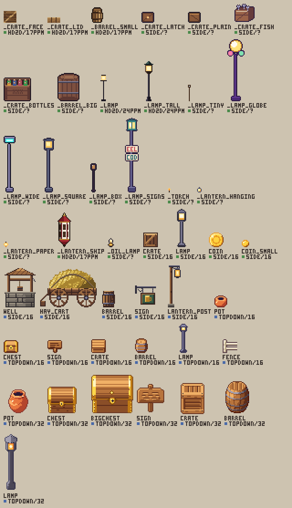
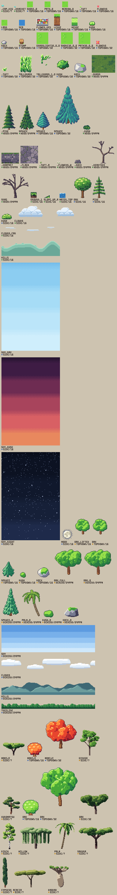
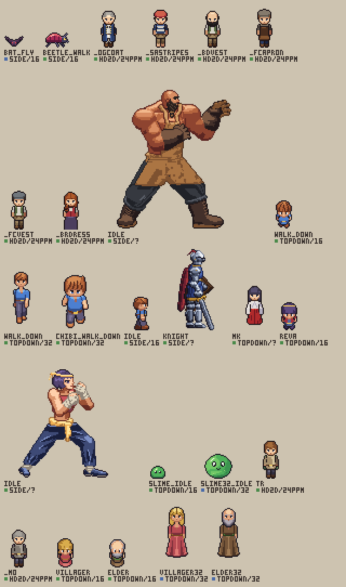
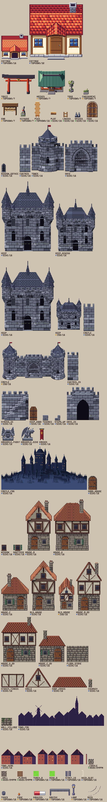
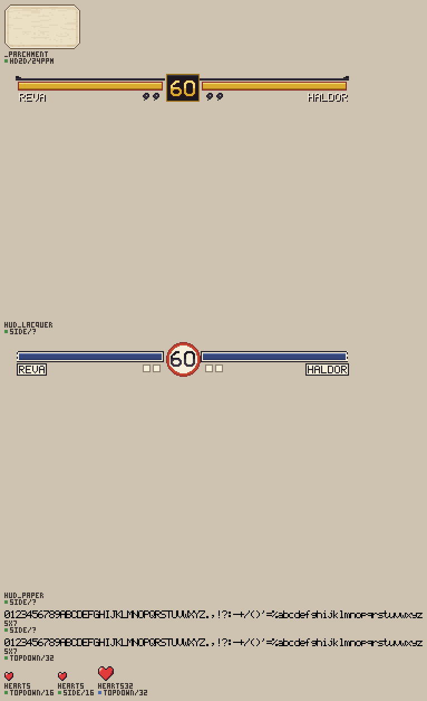
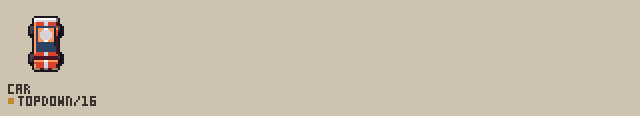
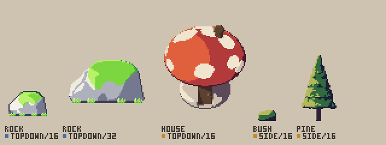
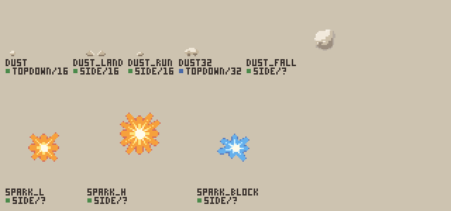

# The library

What pxl draws with, in three layers:

- **the engine** (`src/`): the ops, the builders, the cameras, the light, the export;
- **the library** (here): entries to include rather than redraw, the styles, the profiles;
- **the examples** (`examples/`): finished work, each a profile × entries × a style.

## Taking an entry

Each file holds one kind of thing and says how to take it, in its first lines:

```js
include("<pxl>/lib/props/lamps.px.js", { as: "lamps" })   // its names under lamps.: stamp("lamps._lamp", 40, 60)
sprite("lamp", { base: "lamps._lamp_square", swap: roleSwap(lamps.ROLES._lamp_square, { line: "k", frame: "nM", light: "Llw" }) })
```

- `as` keeps its names apart from yours. Its palette stays with its own drawings unless the file says
  `{ palette: true }` (the nature kit, the HD-2D profile): then its keys are yours too.
- A drawing comes in the colors of the scene it was made for. Its roles (`<kit>.ROLES`) name its keys by
  what they paint (line, wood, light), so `roleSwap()` gives it yours by `base` and `swap`.
- A kit hands out functions and data too (`trees.mats`, `nature.spruce()`, `dialog.PARCHMENT`); the
  names it hands out are full ones (`own()`).
- A 3D thing is a builder, `make3d.oak()`: drawn by `turnaround()` or `draw3d()` at any camera and size.

## What exists, and at which cells

`pxl lib` lists the entries by subject, a line each, with their cells: the camera and the density each
exists at (a tile's px, `topdown/16`; px a meter in a world with no tiles, `hd2d/24ppm`), ✓ approved,
◐ a 3D render to look at, ✎ by hand over a 3D draft (`side/?`: drawn for one scene, neither).
`pxl lib --genre topdown16` keeps those at a profile's cell, `pxl lib --cell side/32` those at a cell.
`pxl lib traveler.tr` prints one's card: what it is, its source, its size, pivot, sockets and frames,
its roles, what varies, and the `include` that takes it. A 3D entry a genre lacks: `pxl lib draft
make3d.oak --genre topdown16` writes and builds an art file to start from, in the genre's camera (what
stands at its `stand` pitch, else its figure's), the genre's box for the card's category (else the card's tiles), its
tones and line (`--cell topdown/16`: a cell alone). A 2D entry at a new density is redrawn simpler, never scaled (`pxl help "scenes 18 19"`).

Each entry's card is a `card()` call just after it in its file: a renamed entry or asset fails the
load at the card's line, and `pxl check` on the file warns where a cell's status disagrees with how
its asset is drawn. A new entry gets one.

## The sheets

Each card's cells, frame 0, its name and cell under it (the swatch: green ✓, amber ◐, blue ✎); a
builder drawn at its first cell. Made by `node scripts/gallery.ts --lib`.

**Props** (`props/`): lamps and crates from the examples' scenes; a top-down village's pot (and its break),
chest, sign, crate, barrel, lamp post and fence (`village.px.js`); its pot, chest and sign at a 32 px grid, with a crate, a barrel, a lamp
and a big chest, each drafted in 3D and finished by hand (`village32.px.js`, `topdown32`); a platformer's crate, lamp post and spinning
coin, side on (`side.px.js`, `platformer16`; at dusk and at night by `props.DUSK` and `props.NIGHT`, the lamp unlit by
day by `props.UNLIT`); a platformer village's well, hay cart, barrel, hanging sign and
lantern post (`side_village.px.js`).



**Nature** (`nature/`): the kit's ground, pines, bushes, rocks and dead trees; the tree species as
builders, the oak, the maple and the spruce also by hand at `topdown/16` (their 3D drafts frozen in
`frozen/`); the cave's caps; the top-down island's ground (`island.px.js`: the shore, a path and a darker
grass by corners, the field's tiles, tall grass, a bank's earth front and a hedge in rows of tiles, flowers
and a bed of them, a bush, a rock, a stump; the same ground at a 32 px grid by its band functions (four drawings a piece, richer), three flowers
redrawn there, tufts, tall grass (and cut), a bush and a rock drafted in 3D and finished by hand: `island32.px.js`, `topdown32`; the oak, the maple, the spruce and the boulder also by
hand at `topdown/32` over their drafts); a platformer's world side on (`side.px.js`, `platformer16`: the
ground as tiles by their open sides under a grass lip, their faces and undersides ragged, slopes, water, an oak, a
pine, two bushes, the backdrop's far and near clouds and hills; `side.ground(map)` draws a level; the same at dusk
and at night by a palette swap, `side.DUSK` and `side.NIGHT`, with the sky as the air at each time, `side.sky`, and
the full moon); the trackside's oak (`make3d.oak_lifted`, its crown lifted so its trunk shows), spruce, bush and rock
for `racing_topdown`, drawn by their 3D builders from its 58 degrees in the track kit's colors, each part lined all
round in its own dark tones (`trackside.px.js`); the same and a palm for `racing_behind`, each at a ladder of sizes for
its distances (`oak_0` to `oak_3`: 64, 32, 16, 8 px tall, `make3d.oak_full`: forking low, its crown full), and the
backdrop strip that wraps in four layers, `sky`, `clouds`,
`hills`, `treeline` (`trackside_behind.px.js`).



**Characters** (`characters/`): the traveler and the people on his figure (the crew, the miko), what
they wear (`dress.px.js`), the top-down hero and the people made from him (`hero.character()`: two villagers,
Reva's chibi), the villager and the elder at 48 px on the slim body (`villagers32.px.js`, by `hero32.character()`), the same hero at 48 px for top-down 32 on the genre's slim body (`hero32.px.js`, `topdown32`: idle,
walk, run and the sword attack with its crescent) and on its chibi body (`chibi_*`, to approve), the same hero side on for a platformer (`hero_side.px.js`,
`platformer16`: idle, walk, run and sprint (a run that speeds up), a dash with its afterimage and dust, a jump in four to loop the rise and the fall (jump, apex,
fall, land), hurt, a ladder's climb and his back at a door), a slime (also at 32),
the knight, a beetle that walks and a bat that flies (a platformer's enemies); Reva the fighter, 110 px side on in KOF
2002's school (`reva_fighter.px.js`, `fighting`: idle, hurt, the walks forward and back, the crouch and its
breath, a straight jump, the blocks standing and low and her normals drawn for their impact (a jab, a cross, a front
kick, a roundhouse to the head, a low kick, a jumping kick), her reactions (hit in the body, hit kneeling, knocked down,
lying, getting up), her specials (a gold wave pushed from both palms, and the wave itself; a rising spinning kick with
a gold trail), her drawings for being thrown (grabbed, folded over an arm, stretched face up and face down, slammed flat on her
face, each turned to the angles a throw asks), in 3D on her rig with her head drawn by hand, hurt and hit boxes
and frame data with the motion an engine applies, 3 palette slots on her sheet); her opponent Haldor the smith, a heavy
grappler 140 px side on (`haldor_fighter.px.js`, `fighting`'s heavy: bald, a braided beard, a leather apron, gauntlets
and boots, in a grappler's low, wide guard, his hands open claws ready to grab; idle, the walks forward and back (a gait
whose legs pass each other), a wrestler's crouch and its breath, a heavy's straight jump, the blocks standing and low,
and his normals as a heavy strikes, his weight dropped into each (a jab, a smith's hammer blow, a boot to the shins, a
push kick facing her, a straight leg shot out from his crouch, a kick in the air) and his throw (a smith's handling: her
folded over his arm, turned over and slammed on her back, bound frame by frame to her thrown drawings, held between his
arms) and his command throw in three strengths (the Sledge, the Anvil, the Rivet: a smith bringing iron down on an
anvil), made as she is, his hands modeled on his rig (their
shape, roll and wrist a pose's numbers), hurt and hit boxes and frame data with the motion an engine applies, 3 palette
slots on his sheet); what the two share, the vectors, the toon, the shadows by design, the cleanup and the boxes, and
her strikes' smear (`fighter.px.js`).



**Architecture** (`architecture/`): the shrine's builders, the HD-2D surfaces, the cottage (by hand at
`topdown/16`, mostly roof, and at `topdown/32` over its draft; its 3D drafts frozen), the island's pier; a platformer's one-way platforms, ladder,
spikes and door (`side.px.js`, at dusk and at night by `built.DUSK` and `built.NIGHT`); a platformer village's old houses as a 3D builder, `make3d.old_house` (a stone
floor, a half-timbered storey, a tile roof and its chimney), finished by hand with the painted doors, windows lit at
dusk and shutters set into its openings, the same three drawn by hand of modules as alternatives (`house_a_2d`...),
its wall and the dusk town behind, by day and at night by `village.TOWN_DAY` and `village.TOWN_NIGHT` (`side_village.px.js`); a haunted castle
as 3D builders, `make3d.castle` (towers, a curtain wall with real crenellations, a gatehouse and its portcullis: any
heading or camera) and `make3d.keep` (the tower-house the walls guard: bartizans, a steep roof, lancets), its curtain,
tower, gate and keep drawn by hand over their side views, lancets, two gargoyles, a banner, the courtyard from inside
(the curtain, the stairs up to the walk, the gate's back, a terrace and the keep's door opening) and the castle on its
crag for the night's backdrop (`side_castle.px.js`). A race track seen from above for `racing_topdown` (`track.px.js`): its corner
tiles, the white edge line (`track_<mask>`) or a kerb (`kerb_<mask>`) on the island's grass, a start line on any of them
(`start_<mask>`, `start_v_<mask>`), a grid slot, `track.skid()` a car's skid marks behind it on any path; and its
things as 3D builders in meters at the car's scale, so racing from above and from behind draw the same models
(`make3d.tyres`, `cone`, `barrier`, `gantry`, `lamp`), drawn at `racing_topdown` from its 58 degrees, each part lined
all round in its material's dark tones, never black (`tyres`, `tyre_wall`, `cone`, `barrier`, `lamp`: twice the car's
scale, the genre's boxes; `gantry`). The track for `racing_behind` (`track_behind.px.js`): its floor's map tiles at 8 px
(`road_<mask>`, `kerb_`, `kerbsand_`, `sand_`, `start_`, `grid_mark`, `boost`, for `plane()`), the track's things from
its camera at a ladder of sizes (`cone_0` to `cone_2`, ...: a rung a doubling of the distance), and a chevron sign, a
guardrail, a flag, a grandstand with its crowd and a blank billboard (`make3d.chevron`, ...); `circuit.rung(name, z)` the
rung for a distance.



**UI** (`ui/`): the dialogue box, the 5x7 font, life hearts (top-down at 16 and 32, side on).



**Vehicles** (`vehicles/`): a car for racing, `make3d.car` (a coupe with a ducktail wing, two liveries by roles,
its roof's mark a decal, sockets `exhaust` and `tow`), turned to its 32 rotations from 58 degrees at
`racing_topdown` (`car_fuego`, `car_laguna`; `car.facing()` a route's heading to its rotation). A kart for
`racing_behind` (Mario Kart's kind), `make3d.kart` (an open pipe-frame kart, two liveries by roles) with the top-down
hero seated in it (`kart.racer()`), turned to its 48 headings (`kart_fuego`, `kart_laguna`; `kart.facing()`), painted
(the hero's own head and face), your kart steering from behind (`kart_fuego_left1` to `_right3`), and a rival at
its size (`kart.rival()`, `kart.LADDER`; its two smallest, 9 and 6 px, drawn by hand: `kart.small()`).



**Styles** (`styles/`): the engine's own builders (`make3d.rock`, `house`, `bush`, `pine`) in the
fields style, drafted at their first cells; `hand32.px.js` the hand pass's steps for a 32 px 3D draft (the draft
itself drawn three times over and brought down by `shrink: { by: 3 }`; `unline32` a draft's line taken off the edge, so
a sprite's `ink` lines it all round; `even32` a lone step evened, for a pass that cuts pieces).



**VFX** (`vfx/`): a puff of dust (top-down at 16 and 32), and side on a landing's, a running heel's and a knockdown's
at a fighter's size; a fighting game's hit sparks, light and heavy, and a block's (`sparks.px.js`) (the volumes'
densities have no picture).



`styles/` holds palettes (and, in `fields`, the cards of the engine's own builders, `make3d.rock`,
`house`, `bush`, `pine`, drawn in its colors), `profiles/` the genres (`topdown16`, `topdown32`,
`platformer16`, `hd2d`, `fighting`, `racing_behind`, `racing_topdown`: each number's source beside
it) and their starter kits, `vfx/` the volumes' densities, dust and sparks.
